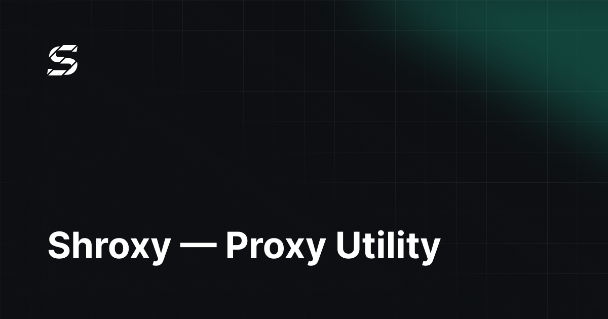

<p align="center">
  
</p>

# Shroxy

A simplified, dark-themed VPN client for Android, based on [v2rayNG](https://github.com/2dust/v2rayNG) and the [Xray core](https://github.com/XTLS/Xray-core). Shroxy rebuilds the v2rayNG experience as a minimal three-screen app: import your subscription, tap connect, done.

> [!WARNING]
> **Read this first.**
> - Shroxy is provided for **personal and educational use only**.
> - **No servers are provided.** Shroxy ships without any configuration — you need your **own subscription** from your own provider.
> - Shroxy is an independent fork and is **not affiliated with or endorsed by 2dust** or the v2rayNG project.
> - You are responsible for complying with the laws of your jurisdiction.

## Features

- **Minimal dark-only UI** — a fully reworked Material 3 interface (palette `#0D0F12` / `#1EE2B6`), no light theme, no clutter. Russian and English only.
- **One-tap connect** — a large animated power button on the Home screen; connection state is always visible.
- **Subscription import** — via QR code, clipboard, or `shroxy://` deep links, with skeleton loading states and per-subscription error states instead of silent failures.
- **Device HWID** — automatic hardware ID (Remnawave-compatible `X-hwid` header) for one-click imports on HWID-gated panels; the HWID is shown and copyable on the empty screen.
- **Hourly subscription auto-update** — subscriptions refresh automatically every hour; the last good configuration is kept on update failure, with start/success toasts.
- **Smart routing** — a "Russian sites direct, everything else via proxy" toggle as an alternative to global mode. LAN traffic is always direct; resolution uses `domainStrategy: IPIfNonMatch`.
- **Bundled geo data** — geoip/geosite from [Loyalsoldier/v2ray-rules-dat](https://github.com/Loyalsoldier/v2ray-rules-dat) ship in the APK, with a daily auto-update at 01:37 and an update-status footer in Settings.
- **Latency testing** — per-row spinners during tests, with an Xray-native measurement fallback for UDP-based protocols (Hysteria2, WireGuard).
- **Country flags** — 270 vector country flags on server rows.
- **Smooth motion** — animated expand/collapse on cards and slide transitions between screens.
- **Quick access** — Quick Settings tile, home-screen widget, and app shortcuts.
- **Per-subscription headers** — an editor for the User-Agent and other HTTP headers sent on subscription fetches.
- **Up to date** — synced with upstream v2rayNG 2.3.14.

## What changed vs upstream v2rayNG

Shroxy is not a reskin — most of the app was rewritten.

- **Rebranding** — new `applicationId` (`com.shroxy.app`), new logo and launcher icons, and a Shroxy User-Agent.
- **Complete UI replacement** — the old drawer/pager/settings stack is gone. The app is three Compose screens: **Home**, **Settings**, **Language**.
- **Dead code removed** — roughly 13,000 lines of unused upstream code and 640+ unused resources deleted.
- **Subscription engine rework** — top-row subscription selection, atomic dedupe of identical URLs, well-defined retry semantics, and honest last-update timestamps.
- **Routing engine** — the two-mode resolver (RU-direct / global) replaces upstream's preset-import routing flow.
- **Geo bundling + scheduler** — geo files are bundled and updated on a schedule instead of requiring manual downloads.
- **HWID support** — automatic `X-hwid` attachment and a panel-compatible import flow.
- **Release signing** — release builds sign via a local `keystore.properties` file (see [Building](#building)).

## Building

### Requirements

- JDK 17+ (bundled with current Android Studio)
- Android Studio with the Android SDK, or a command-line Gradle setup
- Git submodules for the native core sources

### Steps

```sh
# 1. Clone with submodules (native core sources)
git clone --recurse-submodules <this-repo>
# ... or, in an existing checkout:
git submodule update --init --recursive

# 2. Native core inputs
#    libv2ray.aar and the HEV libraries are generated from the
#    AndroidLibXrayLite and hev-socks5-tunnel submodules.
#    Reproduce them by following the steps in .github/workflows/build.yml;
#    outputs belong in V2rayNG/app/libs/.

# 3. Build (run from V2rayNG/)
./gradlew :app:assemblePlaystoreDebug
```

The Android project lives under [`V2rayNG/`](V2rayNG) and can also be opened and built directly in Android Studio.

### Build variants

- `Playstore` — Google Play distribution (default for local development): `:app:assemblePlaystoreDebug`
- `Fdroid` — F-Droid distribution: `:app:assembleFdroidDebug`

Run shared-code changes through both variants when they branch on the distribution flavor. Useful checks:

```sh
./gradlew :app:compilePlaystoreDebugKotlin
./gradlew :app:testPlaystoreDebugUnitTest
```

### Release signing

Optional. Create a `keystore.properties` file in the **repository root**:

```properties
storeFile=/absolute/path/to/your.keystore
storePassword=...
keyAlias=...
keyPassword=...
```

The file is gitignored and never committed. Without it, release builds are produced unsigned.

## Third-party

- Country flag vectors: [lipis/flag-icons](https://github.com/lipis/flag-icons) (MIT), plus the US flag from Twemoji (CC-BY 4.0) — see [`V2rayNG/app/src/main/assets/THIRD_PARTY_NOTICES.md`](V2rayNG/app/src/main/assets/THIRD_PARTY_NOTICES.md).
- GeoIP/GeoSite data: [Loyalsoldier/v2ray-rules-dat](https://github.com/Loyalsoldier/v2ray-rules-dat).

## License

Shroxy is licensed under the **GNU General Public License v3.0** — the same license as upstream v2rayNG. See [LICENSE](LICENSE) for the full text.

If you fork or redistribute Shroxy, you must comply with the GPL-3.0 terms: keep the license, disclose your source, and state the changes you made.

## Acknowledgements

Shroxy is a reworked fork of [2dust/v2rayNG](https://github.com/2dust/v2rayNG), built on [XTLS/Xray-core](https://github.com/XTLS/Xray-core). All credit for the underlying core and the original client goes to their authors and contributors.
